# Phishing Analysis: Fake Recruiter Campaign Impersonating Get Well

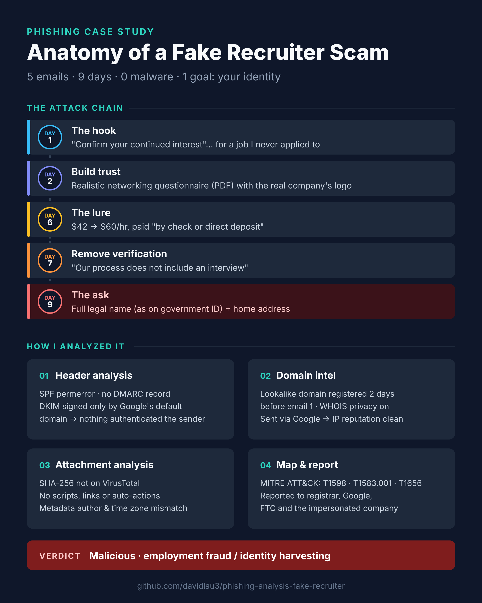

> **Case type:** Employment-fraud / information-harvesting phishing (multi-stage)
> **Analyst:** David Lau (graduating May 2027, applying to new-grad roles)
> **Period observed:** 2026-11-12 to 2026-11-20 (5 inbound emails, 1 attachment)
> **Verdict:** **Malicious**, high confidence

Get Well (GetWellNetwork, Inc.) is a legitimate company and was **impersonated**. It was not involved in this activity. The identity of the real employee whose name was used (name, title, location) has been withheld. All personal details of the recipient are redacted.

---

## 1. Executive Summary

Over nine days, I received a five-email "recruiting" sequence for a remote Junior Network Engineer role. It claimed to come from a member of Get Well's HR team. The emails came from **`getwellnetworkcareers[.]com`**, a lookalike domain registered **two days before the first email**. Get Well's published recruiting security policy states that its recruiters only email from `getwellnetwork.com`, which confirmed the sender was not legitimate.

The campaign moved from low-commitment engagement ("confirm your interest") to a screening questionnaire, then pay-rate lures, a "no interview" explanation, and finally a **request for legal name (as on government ID), home address, email and phone number** to "begin onboarding."

No malware was delivered. The attachment contained no scripts or active content. The threat is **social engineering for personal information**, most likely as a setup for identity theft or payroll/check fraud.

**Key findings:**
- Lookalike domain registered 2026-11-10 (NameSilo, with WHOIS privacy); first email sent 2026-11-12
- **No authentication for the sender's domain:** SPF `permerror` (malformed record), DKIM signed only by Google's default `gappssmtp.com` domain (not aligned with the From domain), no DMARC record
- The real `getwellnetwork.com` publishes DMARC with a quarantine/reject policy, which explains why the attacker registered a new domain instead of spoofing the real one
- Sent through Google Workspace, borrowing Google's IP reputation (clean on AbuseIPDB and WHOIS)
- The attachment's metadata names an author unrelated to the claimed sender, and shows a UTC+01:00 time zone and an `en-NG` language tag, which doesn't fit a US-based HR department (weak indicators)
- **I had never applied to Get Well.** Applying to 10+ jobs a day, I couldn't track every application, so I engaged. The "thank you for your interest" pretext relies on exactly that

---

## 2. Timeline (all times EST)

| Date / Time | Event |
|---|---|
| 2026-11-10 | `getwellnetworkcareers[.]com` registered (WHOIS) |
| 2026-11-12 17:07 | **Email 1:** "Confirmation of Continued Interest" to "Dear Candidate" asks for a reply to stay in consideration |
| 2026-11-12 17:21 | I replied confirming interest (before recognizing the scam) |
| 2026-11-13 09:37 | Questionnaire PDF created (document metadata) |
| 2026-11-13 10:13 | **Email 2:** now "Dear David", with a screening questionnaire attached and a deadline written as `[November 17, 2026]` |
| 2026-11-16 18:43 | I returned the completed questionnaire (name, email, phone; no financial or ID data) |
| 2026-11-17 11:31 | **Email 3:** training pay $42/hr rising to $60/hr; "payments via check or direct deposit"; "recommendations to the Board" |
| 2026-11-17 | Investigation began; no further replies sent |
| 2026-11-18 10:06 | **Email 4:** states the role has **no interview**, only "assessment-driven" selection |
| 2026-11-20 14:04 | **Email 5:** "You have been selected" and requests **legal name as on government ID, residential address, email, phone**, with a deadline of 2026-11-23; promises an offer letter and "credentials for our internal systems" |

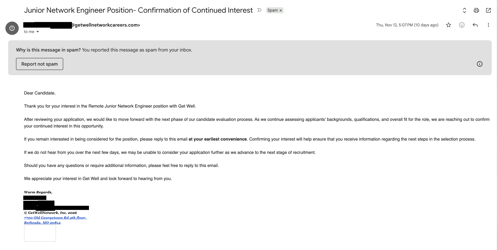
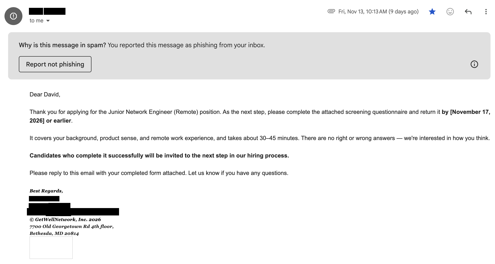
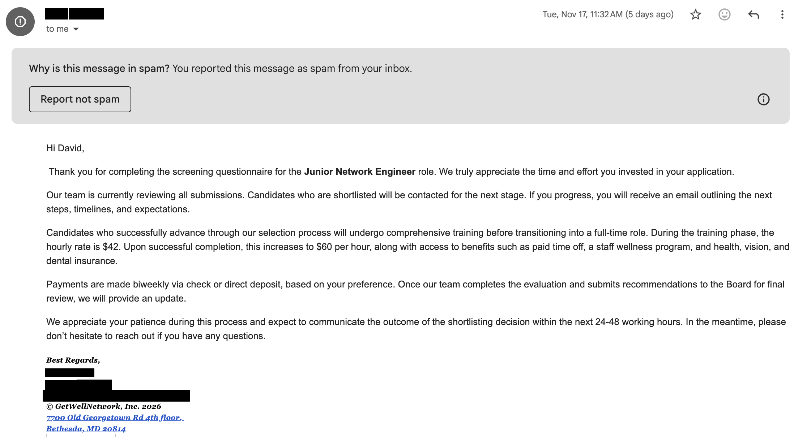
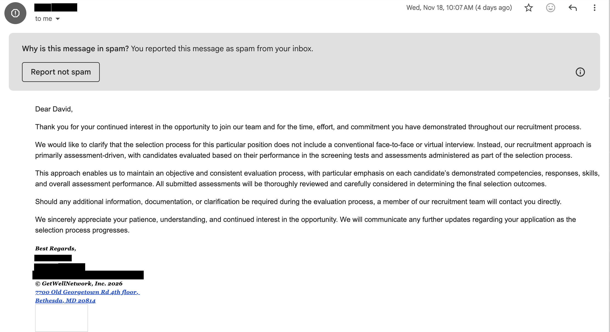
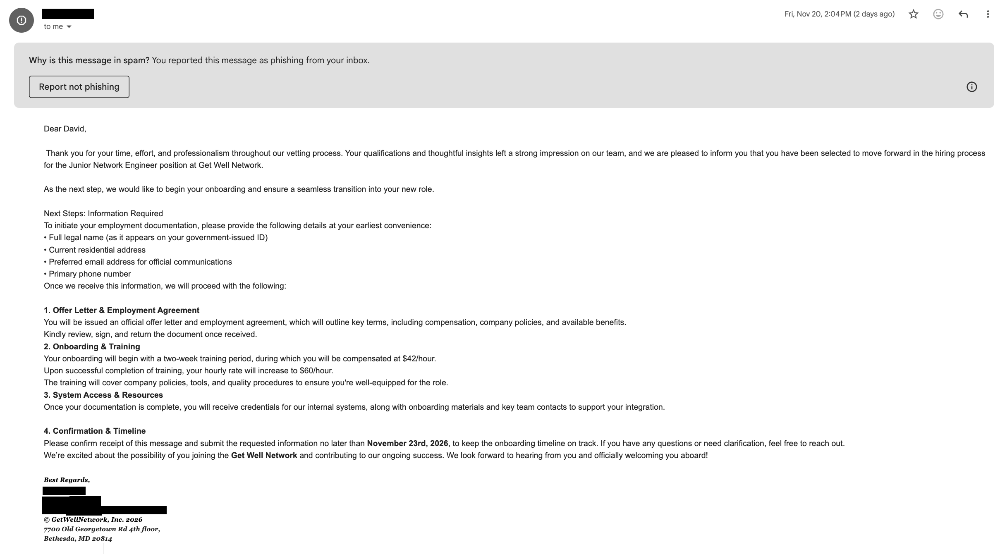

---

## 3. Header Analysis

All five emails share identical sending infrastructure.

| Field | Value | Assessment |
|---|---|---|
| From | `[redacted] <[redacted]@getwellnetworkcareers[.]com>` | Real employee identity copied from LinkedIn; lookalike domain |
| Return-Path | `[redacted]@getwellnetworkcareers[.]com` | Matches From, so not a spoofed envelope; attacker controls the domain |
| Reply-To | *Not present* | Replies go to the From address. (`reply-to` appears only in the DKIM `h=` list, which names headers the signature *covers*, not headers that exist.) |
| Originating server | `mail-sor-f41.google.com [209.85.220.41]`; email 2 used `[209.85.220.65]` | Google outbound mail pool (AS15169); no attacker IP exposed |
| Message-ID | `<CA+kp7Y...@mail.gmail.com>` on all five | Gmail-generated IDs with a consistent prefix, suggesting one sending account or client |
| Threading | `In-Reply-To` / `References` chain my replies (`<CANOg_V...>`) | Confirms one continuous conversation |

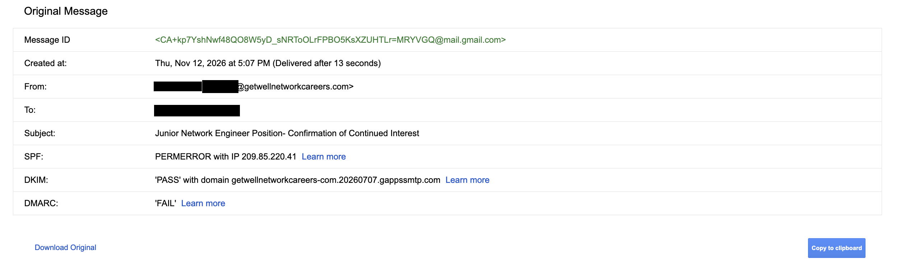

### 3.1 Email Authentication

| Check | Result | Meaning |
|---|---|---|
| **SPF** | `permerror` | The published record is `v=spf1 include _spf.mail.google.com ~all`. It's missing the colon (`include:`), so receivers can't evaluate it |
| **DKIM** | `pass`, but `d=getwellnetworkcareers-com.20260707.gappssmtp.com` | Google Workspace's default signature, applied when the owner hasn't set up DKIM. It proves Google sent the message, **not** that the From domain did (no alignment) |
| **DMARC** | **No record**; Gmail evaluated it as `FAIL` | Neither SPF nor DKIM aligned with the From domain, and with no published policy there is nothing telling receivers to reject the message |

**Comparison with the legitimate domain:**

| | `getwellnetwork.com` (real) | `getwellnetworkcareers.com` (fake) |
|---|---|---|
| Mail provider (MX) | Google Workspace | Google Workspace |
| SPF | Valid | Malformed (`permerror`) |
| DMARC | Published, quarantine/reject | **None** |
| Domain age at first email | Established | **2 days** |
| Listed in Get Well's recruiting security policy | **Yes**, the only domain recruiters use | No |

Both domains use Google, so "sent from Google" isn't the indicator. The difference is configuration and age. A strict DMARC policy on the real domain blocks direct spoofing, so the attacker registered a lookalike domain instead.

**Fake domain:** malformed SPF, no DMARC record
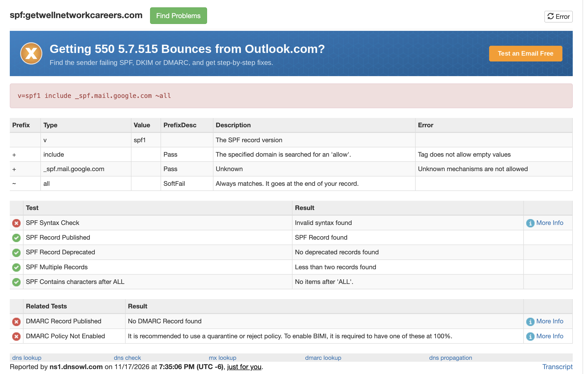

**Real domain:** Google Workspace MX, DMARC quarantine/reject enabled
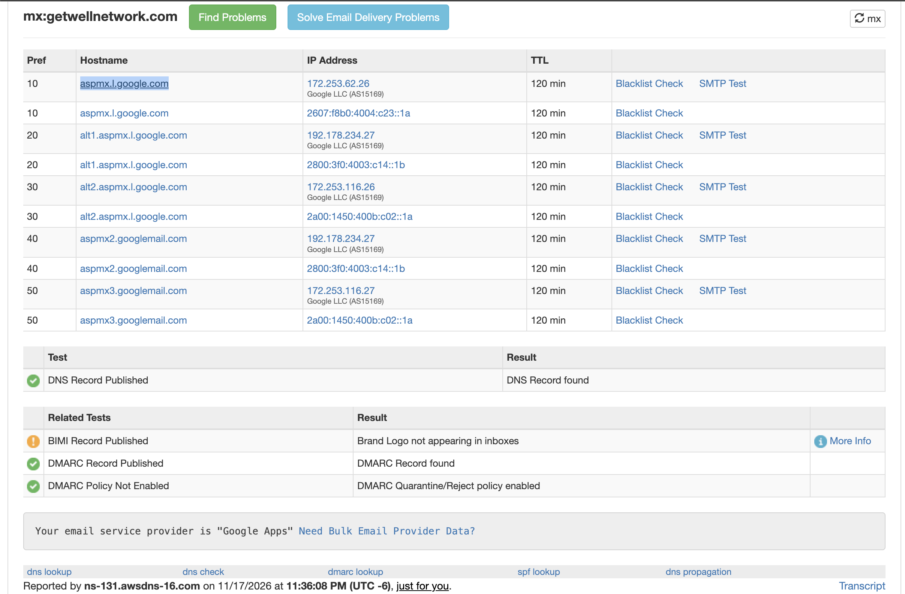

---

## 4. Indicators of Compromise

Defanged. Full list in [`iocs/iocs.csv`](iocs/iocs.csv).

| Type | Value | Notes |
|---|---|---|
| Domain | `getwellnetworkcareers[.]com` | Lookalike, created 2026-11-10 |
| Email | `[redacted]@getwellnetworkcareers[.]com` | Sender |
| DKIM signing domain | `getwellnetworkcareers-com.20260707.gappssmtp[.]com` | Google Workspace default |
| IP | `209.85.220[.]41`, `209.85.220[.]65` | **Google shared infrastructure, do not block** |
| Subject | `Junior Network Engineer Position- Confirmation of Continued Interest` | Plus `Re:` replies |
| File name | `Get Well Screening questionnaire for a Jr Network Engineer (1).pdf` | |
| SHA-256 | `a5450a671a96a3d7a45a4afa23132f97c73c629e54cf074616c77f0a6829baa9` | Not previously seen on VirusTotal |
| SHA-1 | `6d5c1a01bb928c772b3d32ee51ea1b560ec1b31c` | |
| MD5 | `b02dbc50597bb3d00680def74b957693` | |

### 4.1 Reputation Checks

| Indicator | Tool | Result |
|---|---|---|
| `209.85.220.41` | AbuseIPDB / ARIN WHOIS | Google LLC (`209.85.128.0/17`); clean, as expected for shared infrastructure |
| Domain | WHOIS (whois.com) | Registered 2026-11-10 (expires 2027-11-10) through **NameSilo, LLC**; nameservers `ns1-3.dnsowl.com`; registrant hidden behind **PrivacyGuardian.org** |
| Attachment SHA-256 | VirusTotal | No match, so the file hadn't been submitted before (a new or custom document, not a known sample) |

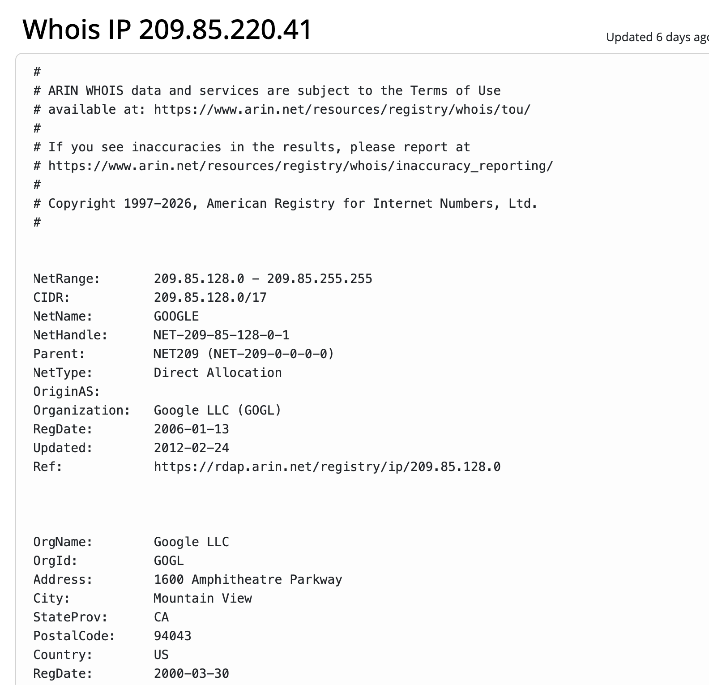
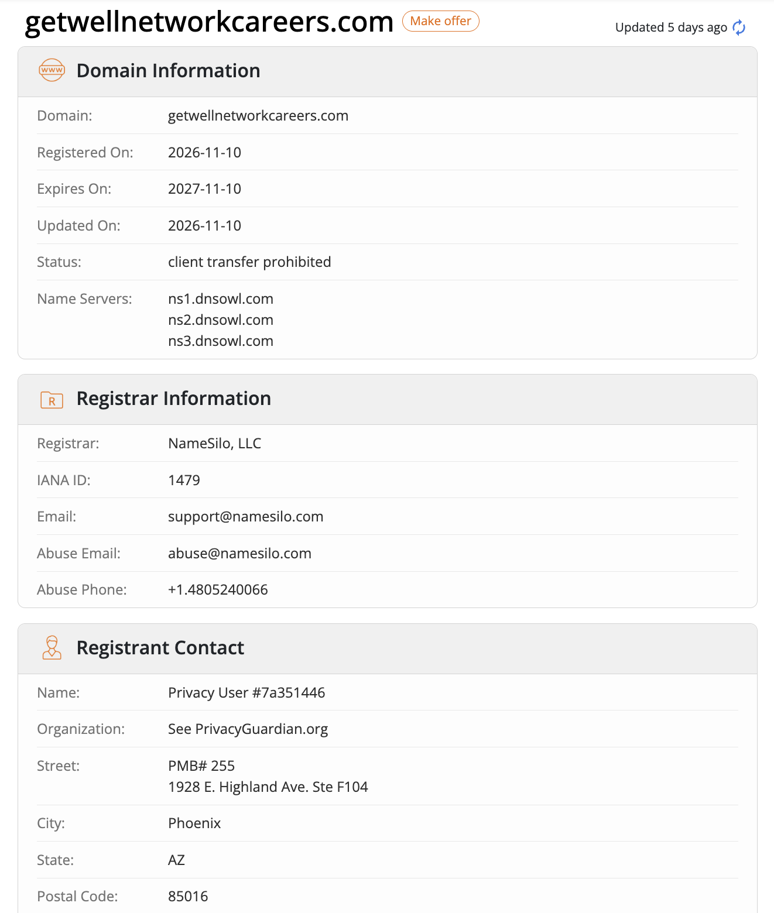
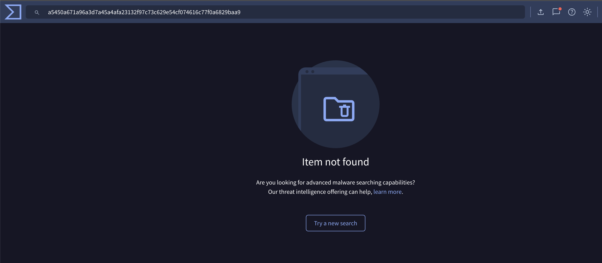

---

## 5. Attachment Analysis

The attachment was extracted from the raw `.eml` and analyzed **without opening it in a PDF reader**.

**Static analysis:** after decompressing all object streams, I checked for active content:

| Keyword | Count |
|---|---|
| `/JavaScript`, `/JS` | 0 |
| `/OpenAction`, `/AA` (auto-actions) | 0 |
| `/Launch`, `/EmbeddedFile` | 0 |
| `/URI` (links), `/SubmitForm`, `/XFA` | 0 |

**Result: no malicious payload.** The PDF is a plain questionnaire of basic networking and scenario questions (OSI model, router vs. switch, troubleshooting). Its "About Us" section is copied from Get Well's real public company description, and it uses the real logo as a watermark. The document's purpose is credibility and engagement, not exploitation.

After I reported email 2 as phishing, Gmail disabled downloading of the attachment.

**Metadata:**

| Field | Value | Observation |
|---|---|---|
| Author | *A personal name unrelated to the claimed sender (withheld)* | Not the HR representative who signed the emails |
| Creator tool | Microsoft Word LTSC | |
| Created | 2026-11-13 09:37 (UTC−05:00) | 36 minutes before email 2 was sent |
| Modified | 2026-11-13 15:39 (**UTC+01:00**) | Same moment as creation (09:39 EST), but recorded by a second tool on a system set to UTC+1 |
| Language tags | `en-US`, `en-NG` | Mixed locale settings |
| File name | `... (1).pdf` | The "(1)" suffix shows a downloaded duplicate, consistent with a reused file |

Time zones and language tags reflect device settings and can be changed. They are **weak indicators that don't fit the claimed US-based sender**, not attribution.

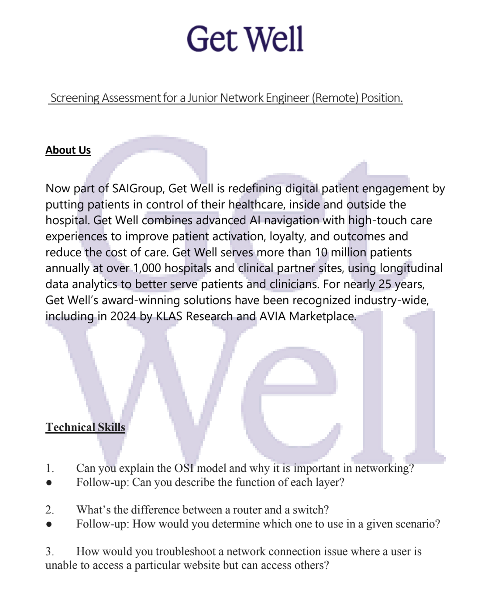

---

## 6. Social Engineering Analysis

| Stage | Tactic | Purpose |
|---|---|---|
| Email 1 | "Confirm your continued interest", sent to "Dear Candidate" | Low-effort ask that filters for responsive targets and confirms a live inbox. The generic greeting suggests mass sending |
| Email 2 | Realistic technical questionnaire; deadline left in template brackets | Builds legitimacy and investment (sunk cost); the brackets show a reused template |
| Email 3 | Above-market pay; "check or direct deposit"; "the Board" | Raises motivation; introduces payment methods early, setting up a later request for bank details or a fake-check scheme |
| Email 4 | "No conventional interview" | Removes the one step where a candidate could verify a real person or company |
| Email 5 | "You've been selected"; requests ID-matching name and home address; 3-day deadline | **The actual ask.** Urgency plus reward; mentions an offer letter and "system credentials" as likely next steps |

**Pretext:** the first email thanked me for my "interest," but **I never applied to Get Well**. As an upcoming May 2027 graduate applying to new-grad roles, I was submitting 10+ applications a day, and at that volume it's hard to keep track of every application. A real company name and a role that matched what I was applying for were enough for me to assume I'd applied and reply. That's exactly the gap this pretext relies on. How my email address was obtained is unknown. Public resume and job-board profiles are a likely source.

**Likely objective (not confirmed):** collect identity information (legal name, address, then likely SSN, ID scans or bank details under the guise of payroll setup), possibly followed by an advance-fee or fake-check "equipment purchase" scheme. I stopped engaging before any financial request.

---

## 7. MITRE ATT&CK Mapping

| Tactic | Technique | Evidence |
|---|---|---|
| Resource Development | **T1583.001**, Acquire Infrastructure: Domains | Lookalike domain registered 2 days before use |
| Resource Development | **T1585.002**, Establish Accounts: Email Accounts | Google Workspace mailbox on the lookalike domain |
| Reconnaissance | **T1598.002**, Phishing for Information: Spearphishing Attachment | Questionnaire PDF used to gather information and build trust |
| Reconnaissance | **T1598**, Phishing for Information | Email 5 directly requests personal identity information |
| Defense Evasion | **T1656**, Impersonation | Identity of a real Get Well employee and the company's real address in the signature |

T1566 (Phishing for Initial Access) was not mapped, because no payload or access attempt was observed.

---

## 8. Verdict

**Malicious, high confidence.** The evidence lines up: a newly registered lookalike domain, no sender-domain authentication, an impersonated real employee, a template artifact, no interview stage, above-market pay, and a final request for identity information.

---

## 9. Response & Recommendations

**Actions taken:**
- [x] Stopped all contact after 2026-11-16
- [x] Reported all five emails in Gmail (as phishing or spam); Gmail then blocked the attachment download
- [x] Reported the abusing account to Google
- [x] Reported the domain to the registrar (abuse@namesilo.com)
- [x] Filed a report with the FTC (ReportFraud.ftc.gov)
- [x] Notified Get Well through its official website

**If this were an enterprise SOC ticket:**
1. Block the sender domain `getwellnetworkcareers[.]com` at the email gateway. **Do not block the Google IPs.**
2. Search mail logs for the domain, subject line and attachment hash to find other recipients.
3. Add the attachment hash to the threat-intel platform.
4. Contact any users who replied; check whether they shared personal or financial data.
5. Share IOCs with the impersonated company.

---

## 10. Lessons Learned

- **Authentication results need context.** "DKIM pass" meant only that Google signed the email. Alignment with the From domain is what matters.
- **Clean reputation isn't clean intent.** Using Google's infrastructure made IP-based checks useless. Domain age and configuration were the real signals.
- **"No malware" doesn't mean "safe."** This campaign never needed a payload. The data request *was* the attack.
- **Verify before engaging.** I replied twice before recognizing the pattern. Checking the sender domain against the company's recruiting security policy would have caught it at email 1.
- **Track applications.** Applying to 10+ roles a day made it impossible to remember every company. I now log every application (company, role, date, where I applied) in a Google Sheet, so I can check any unexpected "thank you for applying" email in seconds.
- **Mistakes are data.** I engaged with a scam. I'm documenting it openly because learning what not to do, and turning it into analysis and future tooling, is more useful than hiding it.
- **Next step:** automate this workflow as an AI-assisted phishing analyzer (header parsing, authentication alignment checks, domain-age lookups, attachment static analysis and LLM-based social-engineering scoring), using this case as ground truth.

---

## Tools Used
Gmail "Show original" · MXToolbox (SPF, DMARC, MX) · VirusTotal · AbuseIPDB · ARIN WHOIS · whois.com · ExifTool · Python (`email`, `hashlib`, `zlib`) for attachment extraction and static analysis

## Repository Structure
```
phishing-analysis-fake-recruiter/
├── README.md
├── iocs/
│   └── iocs.csv
└── screenshots/
```
